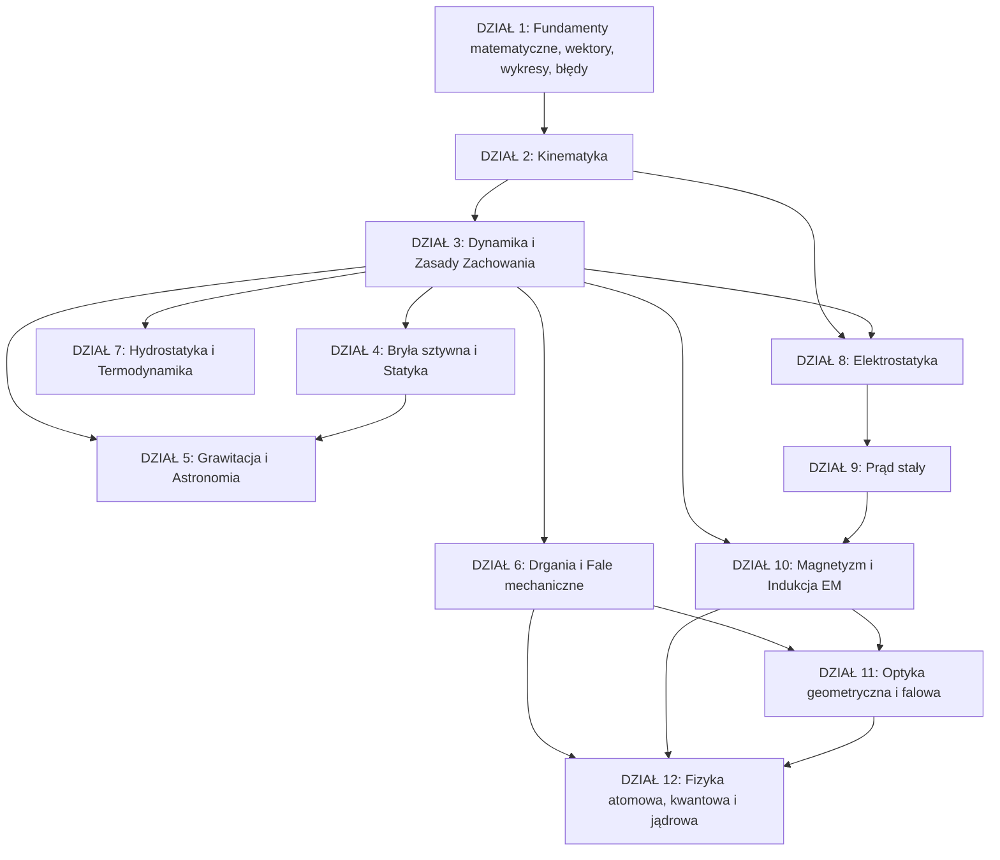

# Szczegółowy Plan Merytoryczno-Techniczny Kursu: Matura Rozszerzona z Fizyki (Formuła 2023, maj 2027)

Dokument stanowi kompletny projekt programowy, merytoryczny oraz architektoniczny kursu **Matura Rozszerzona z Fizyki (od 0 do 100%)**, który będzie kolejnym kursem na wspólnej platformie edukacyjnej (`matura-app/` + `server/`) w jednym repozytorium GitHub obok kursu **Matura Podstawowa z Polskiego**.

---

## 1. Architektura Egzaminu CKE (Formuła 2023) a Struktura Kursu

Egzamin maturalny z fizyki na poziomie rozszerzonym (Formuła 2023) trwa **180 minut**, daje **60 punktów** i wymaga:
- biegłego posługiwania się **Kartą Wybranych Wzorów i Stałych Fizykochemicznych CKE**,
- przekształcania wzorów i wyprowadzania zależności na symbolach (zanim podstawi się liczby),
- analizy wykresów, obliczania niepewności pomiarowych oraz planowania/oceny doświadczeń,
- pisania precyzyjnych uzasadnień słownych („Wyjaśnij, dlaczego…”, „Uzasadnij…”),
- rozwiązywania zadań wieloetapowych łączących kilka działów fizyki.

Aby osoba startująca **od zera** mogła dojść do **100%** bez ścian pojęciowych, kurs został podzielony na **12 działów (`phys-01` – `phys-12`)** ułożonych w ścisłym porządku zależności:



**Zasada twarda:** żaden dział nie odwołuje się do pojęcia ani narzędzia matematycznego z działu późniejszego (np. ruch ładunku w polu elektrycznym pojawia się dopiero po rzucie poziomym; ruch ładunku w polu magnetycznym po dynamice ruchu po okręgu; optyka falowa po falach mechanicznych i elektromagnetycznych).

---

## 2. Szczegółowy Plan 12 Działów Kursu

### DZIAŁ 1: Fundamenty Matematyczne, Wektory, Wykresy i Niepewności (`phys-01`)
*Czas: 6–8 h (Tydzień 1) | Wymagania wstępne: brak (start od 0)*
- **Sekcje notatek:**
  1. `pn1-1` **Układ SI, przedrostki i rachunek jednostek:** jednostki podstawowe i pochodne, zamiana $\text{km/h} \leftrightarrow \text{m/s}$, $\text{cm}^2 \leftrightarrow \text{m}^2$, $\text{g/cm}^3 \leftrightarrow \text{kg/m}^3$, sprawdzanie poprawności wzoru przez analizę wymiarową.
  2. `pn1-2` **Przekształcanie wzorów i trygonometria maturalna:** proporcje, potęgi i pierwiastki, $\sin, \cos, \operatorname{tg}$ w trójkącie prostokątnym, małe kąty.
  3. `pn1-3` **Wektory w fizyce:** skalar vs wektor, dodawanie metodą równoległoboku i wieloboku, odejmowanie wektorów ($\Delta \vec{v} = \vec{v}_2 - \vec{v}_1$), rozkład wektora na osie $X$ i $Y$ ($\cos\alpha, \sin\alpha$).
  4. `pn1-4` **Analiza wykresów i niepewności pomiarowe:** odczyt współczynnika kierunkowego stycznej (pochodna graficzna), pole pod wykresem (całka graficzna), prosta najlepszego dopasowania i prostokąty niepewności, zaokrąglanie wyniku końcowego do cyfr znaczących.
- **Rysunki SVG:**
  - `svg-01-wektory-skladanie.svg` — dodawanie i odejmowanie wektorów.
  - `svg-01-rozklad-na-osie.svg` — rzutowanie wektora pod kątem $\alpha$ na układ $XY$.
  - `svg-01-wykres-styczna-pole.svg` — interpretacja nachylenia stycznej i pola pod krzywą.
  - `svg-01-niepewnosci-prosta.svg` — punkty pomiarowe ze słupkami błędów i prostą dopasowania.
- **Zadania CKE (`arkuszownik.pl`):** zadania doświadczalne z wykresami i niepewnościami z arkuszy 2015–2026 (np. wyznaczanie stałej z nachylenia prostej).

---

### DZIAŁ 2: Kinematyka (`phys-02`)
*Czas: 12–15 h (Tygodnie 2–3) | Wymagania wstępne: Dział 1*
- **Sekcje notatek:**
  1. `pn2-1` **Opis ruchu i względność:** układ odniesienia, tor, droga vs przemieszczenie, prędkość średnia vs chwilowa, składanie prędkości (łódka na rzece, wiatr).
  2. `pn2-2` **Ruch jednostajny i jednostajnie zmienny prostoliniowy:** równania $x(t), v(t), a(t)$, wykresy i przechodzenie między nimi (pole pod $v(t)$ = przemieszczenie!), droga w $n$-tej sekundzie, spadanie swobodne.
  3. `pn2-3` **Rzuty w polu grawitacyjnym:** rzut pionowy w górę, rzut poziomy i ukośny jako złożenie dwóch ruchów niezależnych ($X$: jednostajny, $Y$: jednostajnie zmienny), zasięg, wysokość maksymalna, równanie toru.
  4. `pn2-4` **Ruch jednostajny po okręgu:** okres $T$, częstotliwość $f$, prędkość liniowa $v$ i kątowa $\omega$, przyspieszenie dośrodkowe $a_d = \frac{v^2}{r} = \omega^2 r$ (kierunek i zwrot!).
- **Rysunki SVG:**
  - `svg-02-droga-przemieszczenie.svg` — porównanie toru (drogi) z wektorem przemieszczenia.
  - `svg-02-wykresy-ruchu.svg` — zestaw sparowanych wykresów $x(t), v(t), a(t)$ dla ruchu przyspieszonego i opóźnionego.
  - `svg-02-rzut-ukosny.svg` — parabola rzutu ukośnego z wektorami $v_x, v_y, \vec{v}$ w wybranych punktach toru.
  - `svg-02-ruch-okrag.svg` — wektory $\vec{v}$ (styczny) i $\vec{a}_d$ (do środka) na okręgu.
- **Zadania CKE (`arkuszownik.pl`):** klasyczne zadania z wykresami $v(t)$, zderzeniem/wyprzedzaniem dwóch ciał, rzutami z wysokości i ruchem po okręgu.

---

### DZIAŁ 3: Dynamika i Zasady Zachowania (`phys-03`)
*Czas: 14–16 h (Tygodnie 4–5) | Wymagania wstępne: Działy 1–2*
- **Sekcje notatek:**
  1. `pn3-1` **Zasady dynamiki Newtona i siły podstawowe:** inercjalne i nieinercjalne układy odniesienia (siła bezwładności jako narzędzie pomocnicze), siła ciężkości, reakcja podłoża, naciąg nici, siła sprężystości Hooke'a ($F = kx$).
  2. `pn3-2` **Tarcie i równia pochyła:** tarcie statyczne ($T_s \le \mu_s N$) vs kinetyczne ($T_k = \mu_k N$), rozkład sił na równi pochyłej, układy ciał połączonych (bloczki).
  3. `pn3-3` **Dynamika ruchu po okręgu:** siła dośrodkowa jako *wypadkowa* sił rzeczywistych (samochód na zakręcie, pętla śmierci, wahadło stożkowe).
  4. `pn3-4` **Pęd, popęd i zasada zachowania pędu:** $\vec{F}\Delta t = \Delta \vec{p}$, odrzut, zderzenia sprężyste i całkowicie niesprężyste (wektorowo!).
  5. `pn3-5` **Praca, moc i zasada zachowania energii:** praca siły stałej i zmiennej (pole pod $F(x)$), energia kinetyczna, potencjalna ciężkości i sprężystości, praca sił niekonserwatywnych ($\Delta E_m = W_{zewn} + W_T$).
- **Rysunki SVG:**
  - `svg-03-rownia-pochyla.svg` — pełny rozkład sił ($Q, Q_\parallel, Q_\perp, N, T$) na równi o kącie $\alpha$.
  - `svg-03-uklad-bloczki.svg` — dwa ciała na równi/stole połączone nicią przez bloczek.
  - `svg-03-wahadlo-stozkowe.svg` — siły na masie wirującej na nici i na zakręcie profilowanym.
  - `svg-03-zderzenie-wektory.svg` — bilans pędu przed i po zderzeniu (1D i 2D).
- **Zadania CKE (`arkuszownik.pl`):** zderzenia na lodzie/wózkach, równia z tarciem i sprężyną, pętla w wesołym miasteczku, wahadło balistyczne.

---

### DZIAŁ 4: Bryła Sztywna i Statyka (`phys-04`)
*Czas: 7–8 h (Tydzień 7) | Wymagania wstępne: Działy 1–3*
- **Sekcje notatek:**
  1. `pn4-1` **Moment siły i równowaga statyczna:** ramię siły ($M = r F \sin\alpha$), dwa warunki równowagi ($\sum \vec{F} = 0$, $\sum \vec{M} = 0$), środek masy i stabilność.
  2. `pn4-2` **Dynamika ruchu obrotowego:** moment bezwładności $I$ (Karta Wzorów + twierdzenie Steinera), II zasada dynamiki $M = I\varepsilon$, związek $a = \varepsilon R$.
  3. `pn4-3` **Energia i moment pędu bryły sztywnej:** $E_k = \frac{1}{2}I\omega^2$, staczanie bez poślizgu z równi (kula vs walec vs obręcz), zasada zachowania momentu pędu ($L = I\omega = \text{const}$).
- **Rysunki SVG:**
  - `svg-04-ramie-sily.svg` — definicja ramienia siły $d = r \sin\alpha$ i znak momentu siły.
  - `svg-04-belka-rownowaga.svg` — belka na dwóch podporach / drabina oparta o ścianę.
  - `svg-04-staczanie-rownia.svg` — toczenie bez poślizgu z zaznaczonym punktem styku i siłą tarcia statycznego.
- **Zadania CKE (`arkuszownik.pl`):** równowaga dźwigni/drabiny, rozpędzanie krążka przez spadający ciężarek, wyścig brył na równi, łyżwiarz/karuzela (zachowanie momentu pędu).

---

### DZIAŁ 5: Grawitacja i Astronomia (`phys-05`)
*Czas: 7–8 h (Tydzień 8) | Wymagania wstępne: Działy 1–4*
- **Sekcje notatek:**
  1. `pn5-1` **Pole grawitacyjne:** prawo powszechnego ciążenia Newtona, natężenie pola $g(r)$, spadek $g$ z wysokością i wewnątrz jednorodnej kuli.
  2. `pn5-2` **Energia potencjalna i prędkości kosmiczne:** $E_p = -G\frac{Mm}{r}$ (dlaczego ujemna!), energia całkowita na orbicie, I i II prędkość kosmiczna, stan nieważkości.
  3. `pn5-3` **Prawa Keplera i ruch planet:** orbity eliptyczne, II prawo Keplera jako zasada zachowania momentu pędu ($r_1 v_1 = r_2 v_2$), III prawo Keplera ($T^2 / a^3 = \text{const}$).
- **Rysunki SVG:**
  - `svg-05-natężenie-g-r.svg` — wykres $g(r)$ od środka Ziemi ($r < R_Z$ liniowo, $r > R_Z$ jak $1/r^2$).
  - `svg-05-orbita-kepler.svg` — elipsa z ogniskiem w Słońcu, peryhelium, aphelium i wektory prędkości.
  - `svg-05-studnia-potencjalu.svg` — wykres $E_p(r) = -GMm/r$.
- **Zadania CKE (`arkuszownik.pl`):** satelity geostacjonarne, zmiana orbity (peryhelium/aphelium), obliczanie masy planety z okresu księżyca.

---

### DZIAŁ 6: Drgania i Fale Mechaniczne z Akustyką (`phys-06`)
*Czas: 12–14 h (Tygodnie 9–10) | Wymagania wstępne: Działy 1–3*
- **Sekcje notatek:**
  1. `pn6-1` **Kinematyka i dynamika ruchu harmonicznego:** $x(t) = A\sin(\omega t + \varphi_0)$, prędkość i przyspieszenie ($a = -\omega^2 x$), siła kierująca, wykresy $x(t), v(t), a(t)$.
  2. `pn6-2` **Wahadła i energia drgań:** wahadło sprężynowe ($T = 2\pi\sqrt{m/k}$) i matematyczne ($T = 2\pi\sqrt{l/g}$), wykres przemian $E_k$ i $E_p$, drgania tłumione i rezonans mechaniczny.
  3. `pn6-3` **Fale mechaniczne i interferencja:** fale poprzeczne i podłużne, $v = \lambda f$, równanie fali, zasada superpozycji, interferencja (warunek wzmocnienia i wygaszenia), fale stojące na strunie i w piszczałkach.
  4. `pn6-4` **Akustyka i efekt Dopplera:** natężenie dźwięku i poziom natężenia (decybele), efekt Dopplera dla źródła i obserwatora w ruchu.
- **Rysunki SVG:**
  - `svg-06-oscylator-wykresy.svg` — wykresy $x(t), v(t), a(t)$ przesunięte w fazie o $\pi/2$.
  - `svg-06-energia-drgan.svg` — parabole $E_p(x)$, $E_k(x)$ i linia $E_c = \text{const}$.
  - `svg-06-fale-stojace.svg` — 1., 2. i 3. harmoniczna na strunie oraz w rurze otwartej/zamkniętej.
  - `svg-06-doppler.svg` — zagęszczanie i rozrzedzanie czół falowych przed i za poruszającym się źródłem.
- **Zadania CKE (`arkuszownik.pl`):** odczyt $A, T, \lambda$ z wykresów $y(x)$ i $y(t)$, rezonans, częstotliwość gwizdka pociągu, struny gitary.

---

### DZIAŁ 7: Hydrostatyka i Termodynamika (`phys-07`)
*Czas: 12–14 h (Tygodnie 11–12) | Wymagania wstępne: Działy 1, 3*
- **Sekcje notatek:**
  1. `pn7-1` **Hydrostatyka:** ciśnienie, prawo Pascala (prasa hydrauliczna), ciśnienie hydrostatyczne ($p = \rho g h$), paradoks hydrostatyczny, prawo Archimedesa i warunki pływania ciał.
  2. `pn7-2` **Ciepło, bilans cieplny i przemiany fazowe:** skale Celsjusza i Kelvina, rozszerzalność cieplna, ciepło właściwe, ciepło topnienia/parowania, bilans cieplny.
  3. `pn7-3` **Gaz doskonały i teoria kinetyczno-molekularna:** równanie Clapeyrona ($pV = nRT$), średnia energia kinetyczna cząsteczek ($E_k = \frac{3}{2}k_B T$), prędkość średnia kwadratowa.
  4. `pn7-4` **I zasada termodynamiki i przemiany gazowe:** $\Delta U = Q + W$, praca na wykresie $p(V)$, przemiana izobaryczna, izochoryczna, izotermiczna, adiabatyczna ($Q=0$).
  5. `pn7-5` **Silniki cieplne i II zasada termodynamiki:** sprawność $\eta = W/Q_1$, cykl Carnota ($\eta_{max} = 1 - T_2/T_1$), entropia i kierunek procesów.
- **Rysunki SVG:**
  - `svg-07-archimedes.svg` — siła wyporu i siła ciężkości dla ciała zanurzonego częściowo/całkowicie.
  - `svg-07-przemiany-pv.svg` — wszystkie 4 przemiany na wspólnym wykresie $p(V)$ (porównanie nachylenia izotermy i adiabaty).
  - `svg-07-cykl-silnika.svg` — zamknięty cykl na wykresie $p(V)$ z zaznaczoną pracą użyteczną (pole pętli).
- **Zadania CKE (`arkuszownik.pl`):** bryła lodu z kamieniem w środku, pęcherzyk powietrza wypływający z jeziora, cykle termodynamiczne na wykresach $p(V)$ i $p(T)$, bilans cieplny z topnieniem lodu.

---

### DZIAŁ 8: Elektrostatyka (`phys-08`)
*Czas: 7–8 h (Tydzień 13) | Wymagania wstępne: Działy 1–3*
- **Sekcje notatek:**
  1. `pn8-1` **Ładunek i prawo Coulomba:** kwantyzacja ładunku, zasada zachowania ładunku, prawo Coulomba, superpozycja sił.
  2. `pn8-2` **Pole elektrostatyczne:** natężenie $\vec{E}$, linie pola, pole ładunku punktowego i pole jednorodne między okładkami.
  3. `pn8-3` **Potencjał, napięcie i ruch ładunku w polu:** $E_p = qV$, $U = Ed$ w polu jednorodnym, praca $W = qU$, odchylanie wiązki elektronów w kondensatorze (analogia do rzutu poziomego!).
  4. `pn8-4` **Przewodniki i kondensator płaski:** równowaga elektrostatyczna przewodnika, pojemność $C = Q/U = \varepsilon_0 \varepsilon_r S/d$, energia $E = \frac{1}{2}CU^2$, odłączony vs podłączony do baterii.
- **Rysunki SVG:**
  - `svg-08-linie-pola.svg` — linie pola dwóch ładunków różnoimiennych i jednoimiennych oraz kondensatora płaskiego.
  - `svg-08-elektron-w-kondensatorze.svg` — tor paraboliczny ładunku wlatującego prostopadle do $\vec{E}$.
  - `svg-08-kondensator-dielektryk.svg` — schemat zmiany $C, Q, U, E$ po wsunięciu dielektryka.
- **Zadania CKE (`arkuszownik.pl`):** dwie kulki na nitkach, ruch elektronu między okładkami, wsuwanie dielektryka do kondensatora (podłączonego/odłączonego).

---

### DZIAŁ 9: Prąd Stały (`phys-09`)
*Czas: 12–14 h (Tygodnie 14–15) | Wymagania wstępne: Dział 8*
- **Sekcje notatek:**
  1. `pn9-1` **Natężenie, opór i prawo Ohma:** prąd w metalach, $R = \rho l/S$, zależność $R(T)$ dla metali i półprzewodników (termistor), charakterystyka $I(U)$ żarówki vs opornika.
  2. `pn9-2` **Praca i moc prądu:** $P = UI = I^2 R = U^2/R$, prawo Joule'a-Lenza, sprawność przesyłu energii.
  3. `pn9-3` **Łączenie elementów i prawa Kirchhoffa:** oporniki szeregowo i równolegle, kondensatory w obwodach prądu stałego (po naładowaniu = przerwa!), I i II prawo Kirchhoffa.
  4. `pn9-4` **Źródła napięcia i pomiary:** SEM ($\mathcal{E}$) i opór wewnętrzny ($r$), $U = \mathcal{E} - Ir$, prąd zwarcia, maksymalna moc na odbiorniku ($R = r$), opór własny amperomierza i woltomierza (poprawny i niepoprawny pomiar).
- **Rysunki SVG:**
  - `svg-09-charakterystyka-iu.svg` — porównanie wykresu $I(U)$ dla opornika liniowego i żarówki.
  - `svg-09-kirchhoff-petla.svg` — schemat obwodu z dwoma oczkami, strzałkowaniem prądów i spadków napięć.
  - `svg-09-sem-wykres.svg` — wykres $U(I) = \mathcal{E} - Ir$ z odczytem $\mathcal{E}$ i $r$.
  - `svg-09-mierniki.svg` — dwa układy pomiaru oporu (poprawnie mierzony prąd vs poprawnie mierzone napięcie).
- **Zadania CKE (`arkuszownik.pl`):** wykres $U(I)$ ogniwa, obwody z przełącznikiem (zamknięty/otwarty), żarówki wpięte szeregowo/równolegle, wpływ oporu woltomierza.

---

### DZIAŁ 10: Magnetyzm, Indukcja EM i Prąd Przemienny (`phys-10`)
*Czas: 14–16 h (Tygodnie 16–17) | Wymagania wstępne: Działy 1, 3, 9*
- **Sekcje notatek:**
  1. `pn10-1` **Pole magnetyczne i siła Lorentza:** linie $\vec{B}$ (magnes, prostoliniowy przewodnik, zwojnica), reguły dłoni, $\vec{F}_L = q(\vec{v} \times \vec{B})$, ruch po okręgu ($R = mv/(qB)$) i po linii śrubowej, selektor prędkości i spektrometr mas.
  2. `pn10-2` **Siła elektrodynamiczna:** $F = BIl\sin\alpha$, oddziaływanie dwóch równoległych przewodników z prądem, zasada działania silnika elektrycznego.
  3. `pn10-3` **Indukcja elektromagnetyczna i reguła Lenza:** strumień $\Phi = BS\cos\alpha$, prawo Faradaya ($\mathcal{E} = -\Delta\Phi/\Delta t$), wyznaczanie kierunku prądu indukcyjnego z reguły Lenza, pręt poruszający się po szynach ($\mathcal{E} = Blv$).
  4. `pn10-4` **Samoindukcja, prąd przemienny i fale EM:** prąd sinusoidalny, wartości skuteczne ($U_{sk} = U_0/\sqrt{2}$), transformator, widmo fal elektromagnetycznych.
- **Rysunki SVG:**
  - `svg-10-lorentz-okrag.svg` — tor cząstki w polu $\vec{B}$ (kółko z krzyżykami/kropkami) dla ładunku $+$ i $-$.
  - `svg-10-pret-na-szynach.svg` — pręt zamykający obwód z opornikiem $R$ w polu $\vec{B}$ z zaznaczonym $I_{ind}$ i siłą hamującą $F_{ed}$.
  - `svg-10-transformator.svg` — schemat rdzenia z uzwojeniami $N_1, N_2$.
  - `svg-10-widmo-em.svg` — pełna skala fal EM (od radiowych po gamma) z długościami $\lambda$ i częstotliwościami $f$.
- **Zadania CKE (`arkuszownik.pl`):** spektrometr mas, spadająca ramka w polu magnetycznym, pręt zsuwający się po szynach pochyłych, transformator i przesył mocy.

---

### DZIAŁ 11: Optyka Geometryczna i Falowa (`phys-11`)
*Czas: 7–8 h (Tydzień 18) | Wymagania wstępne: Działy 6, 10*
- **Sekcje notatek:**
  1. `pn11-1` **Odbicie i załamanie światła:** prawo odbicia, prawo Snella ($n_1 \sin\alpha = n_2 \sin\beta$), całkowite wewnętrzne odbicie (światłowód), pryzmat i dyspersja.
  2. `pn11-2` **Soczewki cienkie i zwierciadła:** równanie soczewki ($1/f = 1/x + 1/y$, konwencja znaków dla skupiającej/rozpraszającej i obrazu pozornego!), powiększenie $p = |y|/x$, konstrukcje geometryczne, oko i wady wzroku.
  3. `pn11-3` **Optyka falowa:** doświadczenie Younga, siatka dyfrakcyjna ($d\sin\alpha_n = n\lambda$), maksymalny rząd widma, polaryzacja światła (prawo Malusa / kąt Brewstera jeśli w podstawie — weryfikacja z Kartą Wzorów CKE 2023).
- **Rysunki SVG:**
  - `svg-11-snell-cio.svg` — bieg promienia na granicy ośrodków i kąt graniczny $\alpha_{gr}$.
  - `svg-11-soczewka-konstrukcje.svg` — 3 promienie konstrukcyjne dla obrazu rzeczywistego i pozornego.
  - `svg-11-siatka-dyfrakcyjna.svg` — siatka o stałej $d$ i wiązki ugięte pod kątami $\alpha_1, \alpha_2$.
- **Zadania CKE (`arkuszownik.pl`):** wyznaczanie współczynnika załamania, układ dwóch soczewek / soczewka na ekranie (metoda Bessela), siatka dyfrakcyjna z laserem o dwóch barwach.

---

### DZIAŁ 12: Fizyka Atomowa, Kwantowa, Jądrowa i Elementy Astrofizyki (`phys-12`)
*Czas: 12–14 h (Tygodnie 19–20) | Wymagania wstępne: Działy 6, 10, 11*
- **Sekcje notatek:**
  1. `pn12-1` **Fotony i efekt fotoelektryczny:** energia fotonu ($E = hf = hc/\lambda$), równanie Einsteina ($hf = W + E_{k\max}$), napięcie hamowania ($eU_h = E_{k\max}$), wykres $E_{k\max}(f)$.
  2. `pn12-2` **Dualizm korpuskularno-falowy i atom Bohra:** fale de Broglie'a ($\lambda = h/p$), postulaty Bohra, poziomy energetyczne atomu wodoru ($E_n = -13,6\text{ eV}/n^2$), widma emisyjne i absorpcyjne (serie Balmera, Lymana).
  3. `pn12-3` **Fizyka jądrowa:** budowa jądra ($A, Z$), defekt masy i energia wiązania ($\Delta E = \Delta m c^2$, $1\text{ u} \approx 931{,}5\text{ MeV}$), rozpady $\alpha, \beta^-, \beta^+, \gamma$, prawo rozpadu ($N(t) = N_0 (1/2)^{t/T}$), rozszczepienie i fuzja.
  4. `pn12-4` **Elementy astrofizyki i relatywistyki (zgodnie z podstawą 2023/2027):** przesunięcie ku czerwieni ($z$), prawo Hubble'a, ewolucja gwiazd (diagram H-R) oraz relatywistyczny pęd/energia i dylatacja czasu w zakresie wymaganym przez Informator CKE 2023.
- **Rysunki SVG:**
  - `svg-12-fotoefekt-wykres.svg` — wykres $E_{k\max}(f)$ z zaznaczoną częstotliwością graniczną $f_0$, pracą wyjścia $-W$ i nachyleniem $h$.
  - `svg-12-poziomy-bohra.svg` — schemat przejść elektronowych w atomie wodoru (emisja vs absorpcja).
  - `svg-12-rozpad-wykres.svg` — krzywa zaniku wykładniczego $N(t)$ z zaznaczonymi wielokrotnościami $T_{1/2}$.
- **Zadania CKE (`arkuszownik.pl`):** wyznaczanie stałej Plancka z wykresu $U_h(f)$, przejścia w atomie wodoru, bilans energii w reakcji jądrowej (MeV), datowanie radiowęglowe $^{14}\text{C}$.

---

## 3. Strategia Pozyskiwania i Weryfikacji Zadań z `arkuszownik.pl`

1. **Zakres lat:** arkusze główne (maj), dodatkowe (czerwiec), próbne CKE i pokazowe z lat **2015–2026**.
2. **Filtrowanie pod podstawę 2027:** każde zadanie przed dodaniem do bazy kursu jest oznaczane rokiem, formułą i tagiem działu (`phys-01`..`phys-12`). Zagadnienia wykreślone z podstawy programowej na rok 2027 są pomijane lub oznaczane jako *ponadprogramowe (opcjonalne)*.
3. **Struktura każdego zadania CKE w aplikacji:**
   - Metadane: `rok`, `sesja` (np. `Maj 2024, Formuła 2023`), `numerZadania`, `maxPunkty`, `dzial`, `trudnosc` (`podstawa` / `standard` / `wyzwanie`).
   - Treść zadania + wzory KaTeX + powiązany rysunek SVG (odtworzony wektorowo na wzór arkusza CKE).
   - Podpowiedź naprowadzająca (*„Od czego zacząć?”* — które wzory z Karty Wzorów CKE wybrać).
   - Interaktywna weryfikacja (dla zadań testowych, prawda/fałsz i obliczeniowych z tolerancją jednostek/zaokrągleń) **oraz** pełne rozwiązanie krok po kroku wraz z **oficjalnymi zasadami oceniania CKE** (za co dokładnie jest 1., 2., 3. punkt).

---

## 4. Architektura Integracji z `matura-app/` i `server/` (Jedna Platforma Wielokursowa)

Ponieważ kurs Fizyki ma stanowić spójną całość z kursem Polskiego na jednej stronie i w jednym repozytorium GitHub, rozbudowa `matura-app/` i `server/` przebiegnie według następującego planu:

### 4.1. Struktura katalogów w jednym repozytorium
```text
/ (główne repozytorium GitHub)
├── docs/
│   ├── polski/                  # obecne 00_PLAN_NAUKI.md .. 08_... + pytania ustne/
│   └── fizyka/                  # 00_PLAN_NAUKI_FIZYKA.md, 01_SZCZEGOLOWY_PLAN_KURSU_FIZYKA.md, lekcje .md
├── matura-app/
│   └── src/
│       ├── data/
│       │   ├── courses.js       # rejestr kursów: [{ id: 'polski', ... }, { id: 'fizyka', ... }]
│       │   ├── polski/          # przeniesione obecne course/ + levels.js + oralLevels.js
│       │   └── fizyka/          # phys01..phys12.js, physicsTasks.js (zadania z arkuszownik.pl)
│       ├── components/
│       │   ├── CourseSwitcher.jsx   # przełącznik kursu w Sidebarze i na WelcomePage
│       │   ├── MathText.jsx         # renderer KaTeX dla tekstu mieszanego (prose, fiszki, quizy, zadania)
│       │   ├── DiagramRenderer.jsx  # obsługa responsywnych diagramów SVG (light/dark mode)
│       │   ├── ExamTaskView.jsx     # moduł zadań maturalnych CKE krok po kroku + klucz CKE
│       │   └── ... (istniejące NotesView, FlashcardsView, QuizView współdzielone przez oba kursy)
└── server/
    └── store.js                 # przestrzeń nazw postępów per kurs: progress.polski / progress.fizyka
```

### 4.2. Rozszerzenie schematu danych (`types.ts`)
Istniejące komponenty (`NotesView`, `FlashcardsView`, `QuizView`) zostaną zachowane i rozszerzone tak, aby obsługiwały oba kursy bez duplikacji logiki:
- **`ContentBlock` w `StudyNote`:** dodanie nowego typu bloku `DiagramBlock` (`{ type: 'diagram', svgId: string, caption: string, alt: string }`) oraz renderowanie `$...$` i `$$...$$` przez `MathText.jsx` (KaTeX).
- **`Flashcard`:** rozszerzenie kategorii o kategorie fizyczne (`'wzor' | 'jednostka' | 'prawo' | 'zjawisko' | 'wykres' | 'doswiadczenie'`).
- **`CourseDepartment`:** opcjonalne pole `examTasks: ExamTask[]` z zadaniami maturalnymi CKE z `arkuszownik.pl` przypisanymi do danego działu.

### 4.3. Backend (`server/`) i postępy użytkownika
- Jedno konto użytkownika (logowanie JWT w `server/auth.js`) przechowuje postępy dla obu kursów osobno (`courses: { polski: {...}, fizyka: {...} }`), z zachowaniem pełnej kompatybilności wstecznej dla dotychczasowych kont kursu Polskiego.
- Wspólny system XP i statystyk na koncie (z podglądem postępu osobno dla Polskiego i Fizyki).

---

## 5. Kolejność Wdrożenia po Akceptacji Planu

1. **Etap 1 (Architektura wielokursowa):** Refaktoryzacja `matura-app/` i `server/` pod obsługę wielu kursów + instalacja `katex` i budowa `MathText.jsx`, `DiagramRenderer.jsx`, `CourseSwitcher.jsx` oraz `ExamTaskView.jsx`.
2. **Etap 2 (Faza I — Mechanika):** Utworzenie `phys-01` do `phys-05`, wygenerowanie wszystkich rysunków SVG i osadzenie zadań CKE (2015–2026) z `arkuszownik.pl`.
3. **Etap 3 (Faza II — Drgania, Termodynamika, Elektryczność):** Utworzenie `phys-06` do `phys-09` + SVG + zadania CKE.
4. **Etap 4 (Faza III — Magnetyzm, Optyka, Fizyka Współczesna):** Utworzenie `phys-10` do `phys-12` + SVG + zadania CKE.
5. **Etap 5 (Faza IV — Pełne arkusze i testy):** Dodanie trybu pełnych arkuszy próbnych + testy E2E i build produkcyjny.
